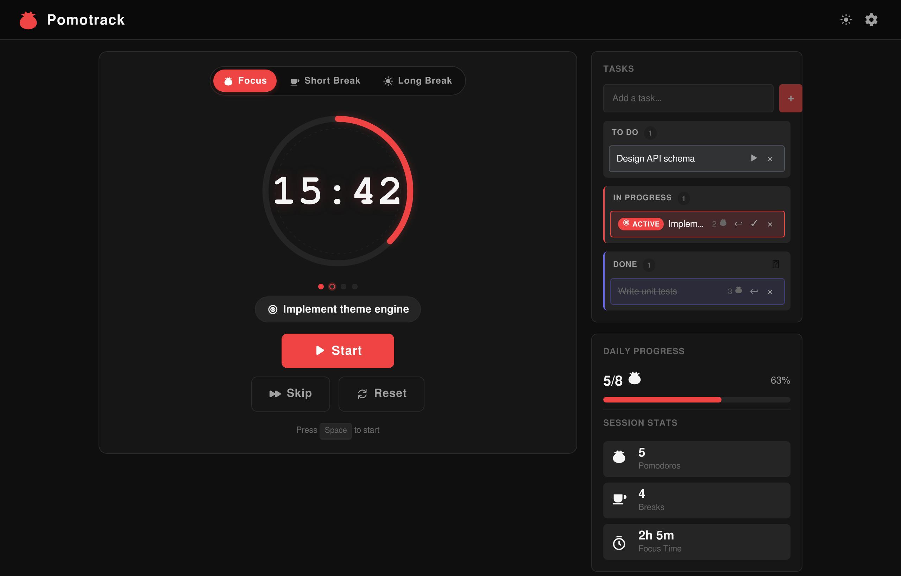
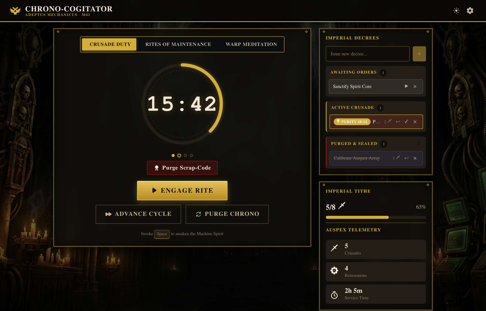
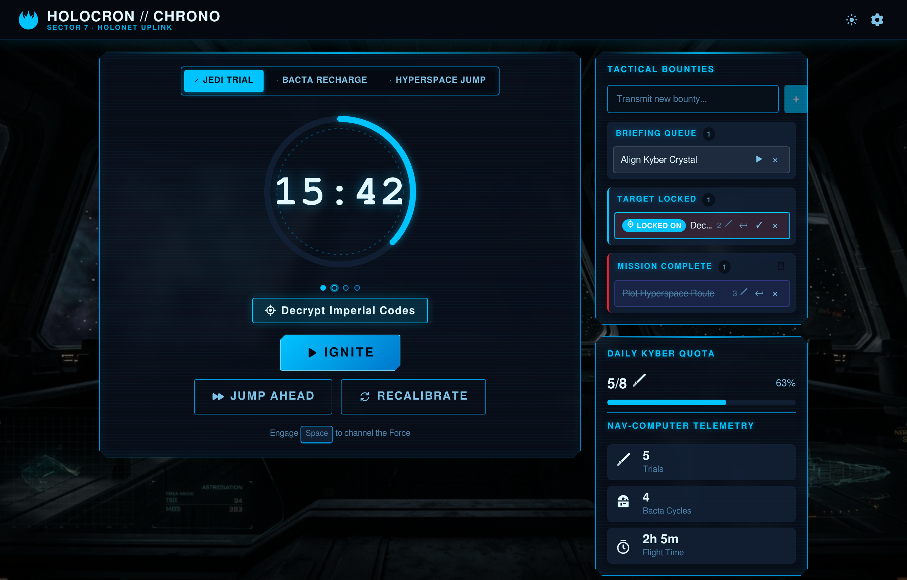

# 🍅 Pomotrack

A self-hosted, single-user Pomodoro timer and Kanban task tracker with full visual themes — packaged in a single Docker container.

> ⚠️ **Security Notice:** Designed for personal/LAN use without authentication. Do **not** expose directly to the public internet without a VPN or authenticated reverse proxy.

## Screenshots

### Default Theme


### Warhammer 40K Theme (*Chrono-Cogitator · Adeptus Mechanicus*)


### Star Wars Theme (*Holocron // Chrono · Command Bridge*)


---

## Features

- **Timer & Modes**: Direct session-mode switcher (**Focus** · **Short Break** · **Long Break**), circular progress ring, cycle progress dots, urgency warnings, configurable durations, and auto-start options.
- **Full Visual Themes**: File-driven theme engine ([`frontend/src/themes/themes.json`](frontend/src/themes/themes.json)) with 3 built-in themes (**Default**, **Warhammer 40K**, **Star Wars**) plus Dark/Light mode support. Customizes background artwork, vector SVG emblems, fonts, panel frames, and in-universe terminology.
- **Kanban Task Board**: 3-column board (*To Do* → *In Progress* → *Done*) with drag-and-drop, one-click/touch task progression (`▶`, `↩`, `✓`, `×`), active task badge (`🎯`), and automatic Pomodoro counting per task.
- **Analytics & History**: Daily goal progress bar, session labeling with quick presets, and multi-period summary modal (*Today* / *This Week* / *This Month*) with proportional time-by-label bars.
- **Alerts & UX**: Audio alerts (`/sounds/bell.wav` + Web Audio fallback), browser notifications, Screen Wake Lock, dynamic progress favicon, compact mode, and keyboard shortcuts (`Space`, `S`, `R`, `Escape`).
- **Persistence & Cloud Sync**: SQLite persistence for sessions and Kanban tasks, plus optional Azure Blob Storage push/pull sync with conflict resolution (`keep_local`, `keep_cloud`, `keep_newer`).

---

## Quick Start

### Docker Compose (Recommended)
```bash
docker compose up -d --build
```
Open **http://localhost:8080**. SQLite data persists in the `pomotrack-data` Docker volume.

### Local Development
**Prerequisites:** Python 3.11+, Node.js 26 (LTS), `uv`

```bash
# Backend (port 7070)
cd backend
uv sync
uv run uvicorn app.main:app --reload --port 7070

# Frontend (port 5173, proxies /api -> :7070)
cd frontend
npm install
npm run dev
```

---

## Customizing Themes

Themes are defined in [`frontend/src/themes/themes.json`](frontend/src/themes/themes.json). Each theme entry configures:
- `id`, `name`, `icon`, `description`, `tagline`, and `backgroundImage`
- `fonts`: `--font-body`, `--font-heading`, `--font-mono`
- `labels`: In-universe terminology for modes, controls, Kanban columns, and stats
- `colors.dark` & `colors.light`: CSS custom properties for backgrounds, borders, text, and session accents

Switch themes anytime in **⚙️ Settings → Theme**.

---

## Keyboard Shortcuts

| Key | Action |
| :--- | :--- |
| `Space` | Start / Pause timer |
| `S` | Skip session |
| `R` | Reset session |
| `Escape` | Close modals |

## License
MIT / Public Domain — do whatever you want with it.
