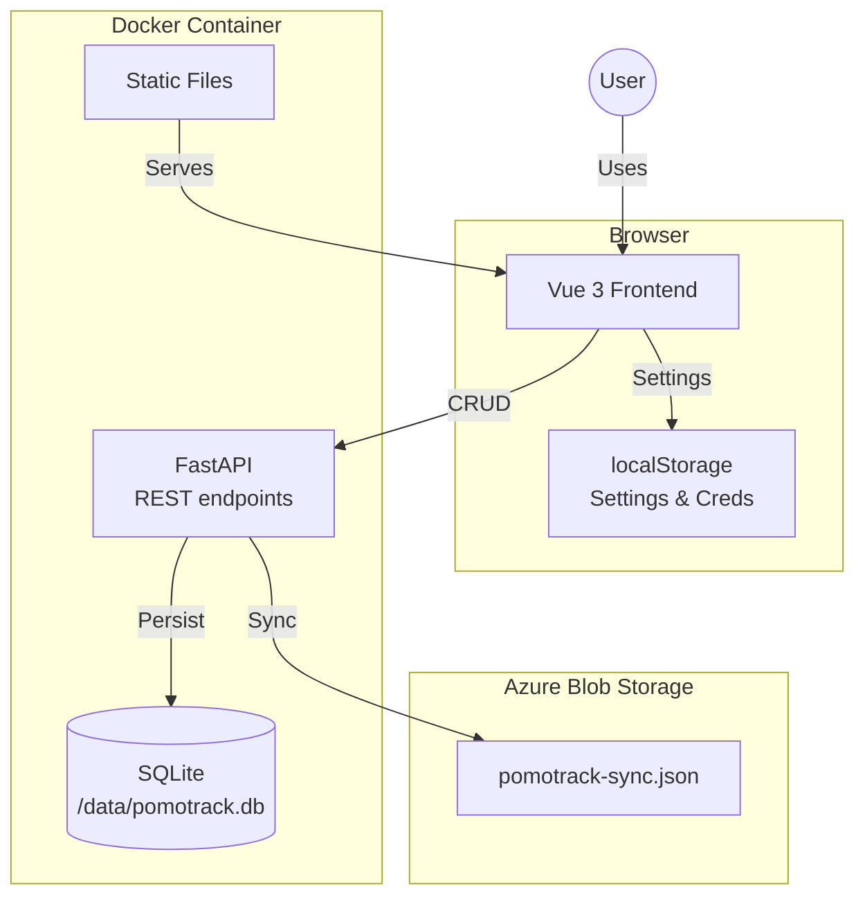
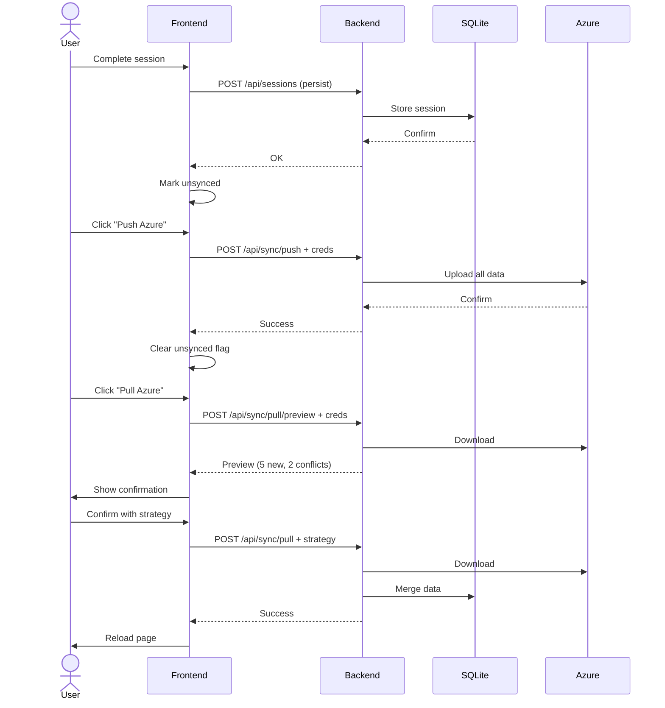

# Pomotrack

A self-hosted, single-user Pomodoro timer — simple to use, simple to run.

> ⚠️ **Security Notice:** LAN-only. No authentication. Do **not** expose to the public internet. Use a VPN or authenticated reverse proxy for remote access.

## Features

### Timer
- 🍅 Standard Pomodoro: Focus → Short Break → Long Break
- ⭕ Circular progress ring
- ⚙️ Configurable durations
- 🔄 Auto-start sessions
- ⏭️ Skip / reset
- ⚠️ Urgency warnings (2min/30s)

### Notifications & Alerts
- 🔔 Browser notifications
- 🏆 Daily goal celebrations
- 🔊 Audio alerts (bundled `/sounds/bell.wav` + synthesized fallback)
- 📱 Wake Lock (prevents screen sleep)

### Tracking & Stats
- 📊 Daily statistics
- 🎯 Goal progress tracking
- 🏷️ Session labeling
- 📈 Multi-period summary (Today / Week / Month)

### Kanban (Optional)
- 📋 3-column board (Todo → In Progress → Done)
- 🖱️ Drag-and-drop
- 🍅 Automatic pomodoro counting
- 💾 SQLite persistence

### Cloud Sync (Optional)
- ☁️ Push/pull to Azure Blob Storage
- 🔄 Sync between multiple machines
- 🤖 Optional auto-sync (startup pull + post-session push)
- 🔐 Credentials stored in browser only
- 🚀 Bootstrap new machines

### Interface
- 🌙 Dark/Light theme + OS detection
- 📐 Compact mode
- ⌨️ Keyboard shortcuts (Space, S, R, Escape)
- 🔖 Dynamic favicon
- 💾 Settings persist in localStorage

## Quick Start

### Docker Compose
```bash
docker compose up -d
```
Open <http://localhost:8080>. Data persists in `pomotrack-data` volume.

### LAN Access
Access via your machine's IP (e.g., <http://192.168.1.100:8080>).

### Development
**Prerequisites:** Python 3.11+, Node.js 20+, uv

```bash
# Backend
cd backend
uv sync
uv run uvicorn app.main:app --reload --port 7070

# Frontend
cd frontend
npm install
npm run dev
```
Open <http://localhost:5173>. Vite proxies `/api` to backend at port 7070.

## Keyboard Shortcuts
| Key | Action |
|-----|--------|
| `Space` | Start/Pause timer |
| `S` | Skip session |
| `R` | Reset session |
| `Escape` | Close modals |

## Architecture



### Data Flow



### Project Structure
```
pomotrack/
├── backend/
│   └── app/
│       ├── main.py       # Entry point & static serving
│       ├── database.py   # SQLite engine
│       ├── models.py     # SQLModel tables
│       └── api/
│           └── routes.py # REST endpoints
├── frontend/
│   └── src/
│       ├── api/          # Typed API wrappers
│       ├── components/   # Vue components
│       └── composables/  # Logic (timer, sync, storage)
├── Dockerfile
└── docker-compose.yml
```

## Configuration

### Timer
| Setting | Default | Description |
|---------|---------|-------------|
| Focus duration | 25 min | Focus session length |
| Short break | 5 min | Short break length |
| Long break | 15 min | Long break length |
| Long break after | 4 🍅 | Pomodoros until long break |
| Daily goal | 8 🍅 | Target pomodoros per day |

### Behavior
| Setting | Default | Description |
|---------|---------|-------------|
| Auto-start breaks | Off | Auto-start break after focus |
| Auto-start focus | Off | Auto-start focus after break |
| Keep screen on | Off | Prevent screen sleep |

### Alerts
| Setting | Default | Description |
|---------|---------|-------------|
| Sound | On | Play alert on session end |
| Notifications | Off | Browser notifications |
| Urgency warning | On | Visual pulse near end |

### Display
| Setting | Default | Description |
|---------|---------|-------------|
| Theme | Auto | Dark/Light (OS detection) |
| Compact mode | Off | Smaller UI |
| Kanban board | Off | Enable task board |

## Cloud Sync

Sync sessions and kanban tasks to Azure Blob Storage across multiple machines.

### Setup
1. Create Azure Storage account + container
2. Get Access Key from Azure portal
3. Enter in Settings → Cloud Sync
4. Optional: enable Auto-sync (pull on startup, push after focus sessions)

### Pull Behavior
Pull now **merges** by default (not replaces). Shows confirmation dialog with:
- New sessions/tasks count
- Updated items count  
- Conflicts count
- Conflict resolution strategy selector

Auto-sync uses silent pull on startup (`keep_local`) and shows a `Syncing...` toast.

**Conflict Strategies:**
- `Keep local` (default): Preserve your local data
- `Use cloud`: Overwrite with cloud data
- `Keep newer`: Use most recent by timestamp

> ⚠️ **Note:** Original replace-all behavior available via API with `merge=false`.

### Endpoints
| Method | Endpoint | Description |
|--------|----------|-------------|
| POST | `/api/sync/push` | Upload data to Azure |
| POST | `/api/sync/pull` | Merge/import from Azure |
| POST | `/api/sync/pull/preview` | Preview changes |
| GET | `/api/sync/info` | Get metadata |

### Pull Request
```json
{
  "accountName": "your-account",
  "containerName": "container",
  "accountKey": "key",
  "merge": true,
  "conflictStrategy": "keep_local"
}
```

### Pull Response
```json
{
  "ok": true,
  "importedSessions": 5,
  "importedTasks": 2,
  "mergedSessions": 1,
  "mergedTasks": 0,
  "conflicts": 1
}
```

## Design Decisions
- **Client-side timer**: Works offline, no server dependency
- **localStorage settings**: Theme, preferences persist in browser
- **SQLite data**: Sessions/tasks survive browser clears, shared on LAN
- **Single container**: Frontend + backend in one Docker container
- **Optimistic UI**: Immediate UI updates, API calls in background
- **Manual sync default**: Cloud sync is opt-in, manual by default
- **No auth**: Single-user, LAN-only design

## Recent Changes

### 2026-10
- Pomodoro cycle dots on the timer (progress toward the long break)
- Confirmation modal for "Clear all data" (replaces native `confirm()`)
- SVG icons (Heroicons) for timer controls and header buttons
- Toast accessibility (`role="status"`/`alert` for screen readers)

### 2026-02
- SQLite persistence for sessions/kanban
- Manual Azure Blob sync
- Migration from localStorage to backend
- Payload validation, transactional imports
- Backend sync tests

### 2026-06
- Pull merges by default (not replaces)
- `/api/sync/pull/preview` endpoint
- `/api/sync/info` endpoint
- Conflict resolution: keep_local, keep_cloud, keep_newer
- Pull confirmation dialog
- Auto-sync toggle (startup pull + post-focus push)

## Browser Support
| Browser | Support |
|---------|---------|
| Chrome/Edge | ✅ Full (including Wake Lock) |
| Firefox | ✅ Full (no Wake Lock) |
| Safari | ✅ Full (no Wake Lock) |

## License
Do whatever you want with it.
